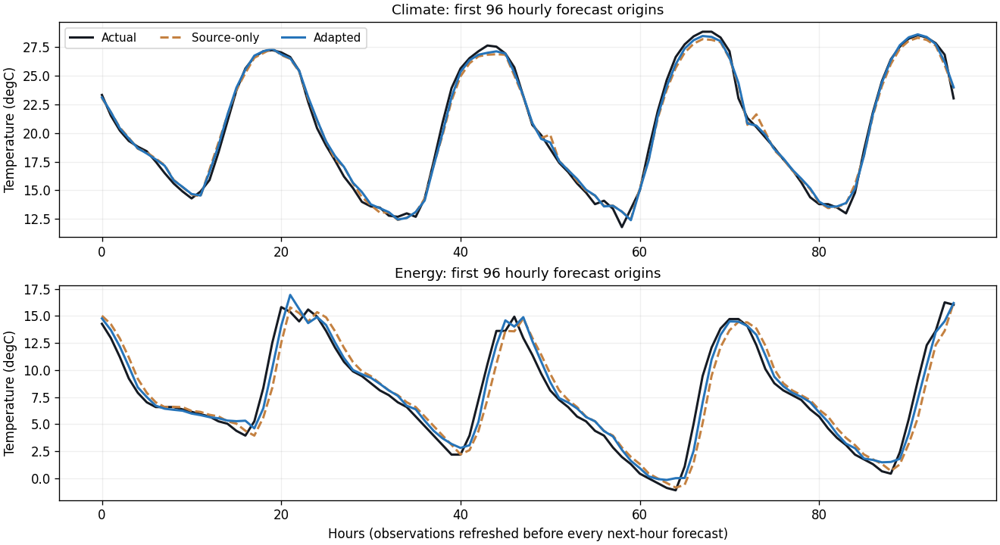
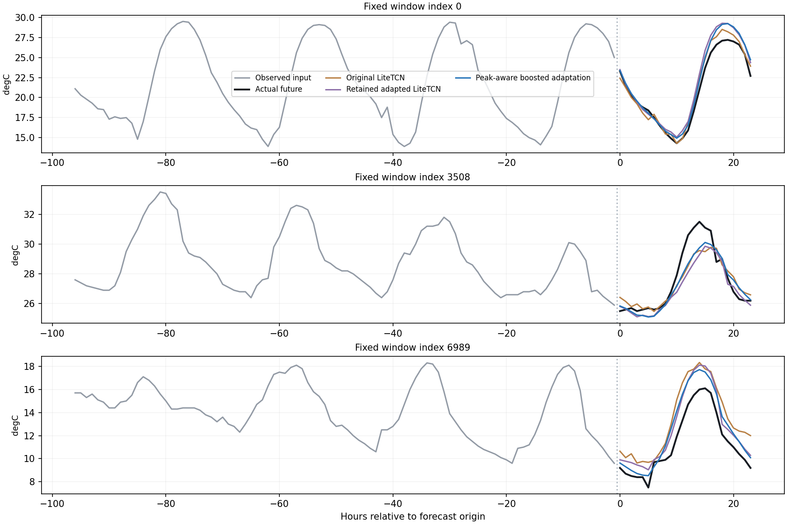
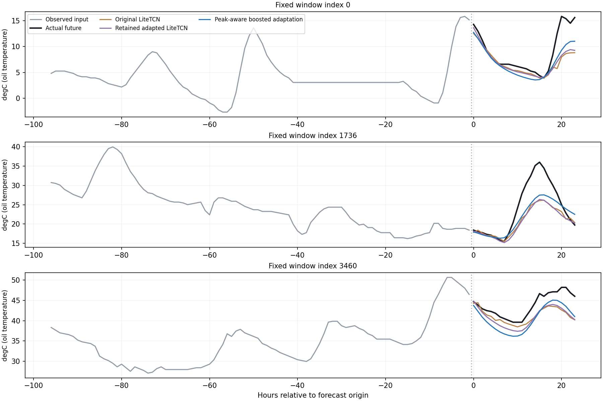
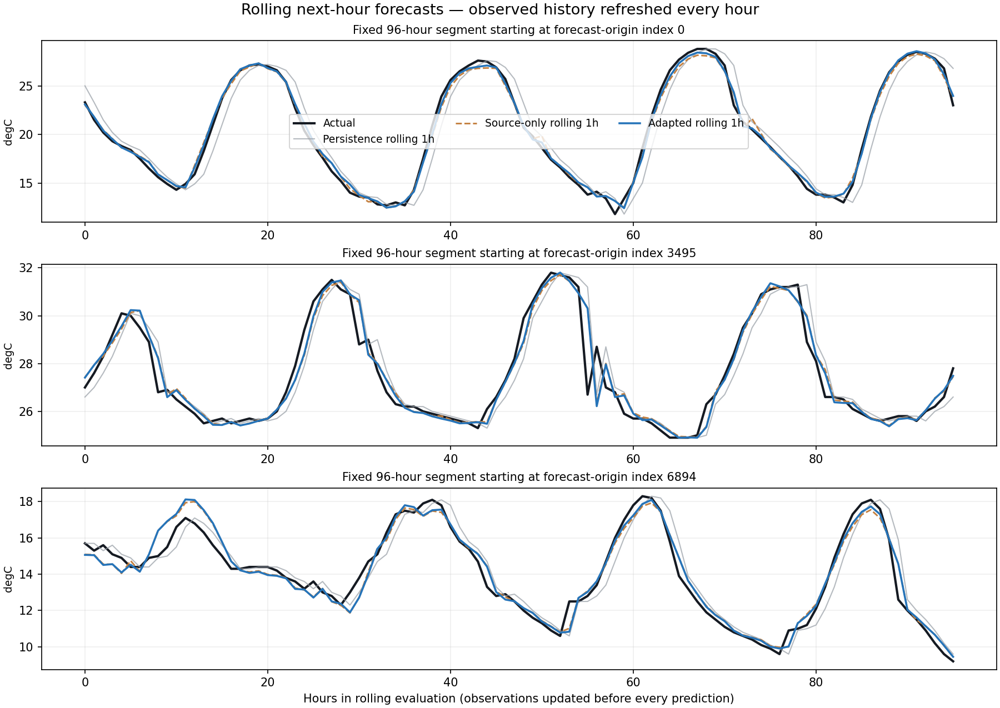
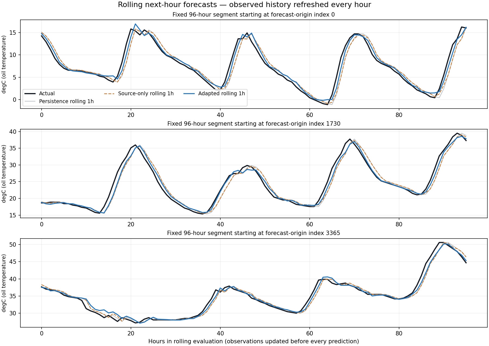
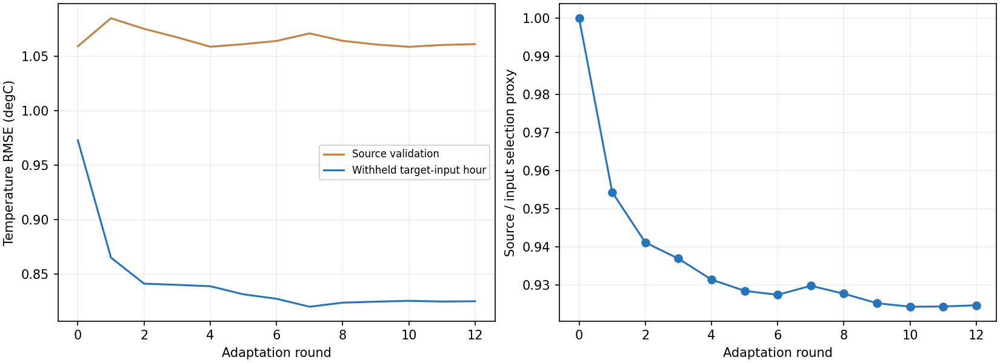
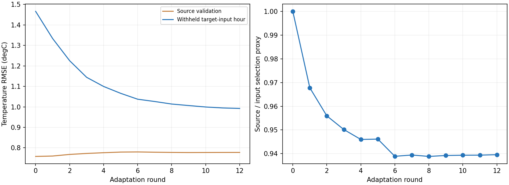
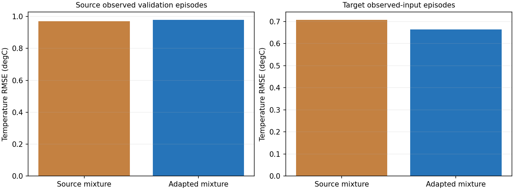
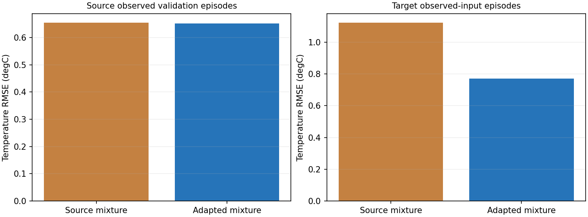

# IE643: Complete Project and Intensive Assessment Guide

**Prepared from the repository and saved experiments; updated 20 October 2026 (IST).**  
**Team: DeepGen. Team members:** Ayush Patel — 23B0037; Rishik Yadav — 23B2103.  
**Purpose:** understand, explain and defend the work in the intensive assessment presentation and viva.

This is a study guide, not the prescribed final project report or an updated slide deck. The assessment instructions require an official-template PDF report and the team's own explanation of its work. Use this guide to learn the implementation, verify the evidence and prepare that explanation. The user supplied the team name and allocation: both members researched methods and carried out experiments; Ayush developed the dashboard/application, and Rishik prepared the report/presentation. TA dataset approval still needs confirmation.

**How to use it:** for a quick revision, read sections 1, 13, 14 and 23. For the technical viva, study sections 3–11 and practice section 20 without looking at the answers. For presentation preparation, use sections 17–19 and rehearse with a timer. The full guide is deliberately more detailed than a slide deck.

[TOC]

## 1. The project in two minutes

The task is **multivariate time-series forecasting under a change of domain**. First learn to forecast in a source domain. Then adapt that model to a target domain whose behavior differs. We evaluate this on three source-to-target pairs: Shimla to Delhi weather, IT to pharma financial features, and ETTh1 to ETTh2 transformer measurements.

The original solution used a small temporal convolutional network, **LiteTCN**, with reversible normalization and a parallel linear forecasting path. The original adaptation family, called **CARE-DA** in this repository, combined source forecasting, distribution alignment, self-supervision on target inputs and an anchor to the source model. These names refer to this project's implementation, not a claim of a published algorithm with that name.

Later work tested deeper LiteTCNs, a patch MLP, DLinear-inspired models, channel-specific ridge predictors, guarded ensembles, several TCN revisions and explicit peak-sensitive losses. Increasing depth did not consistently help. At the original long horizons, stronger linear/hybrid models improved the numerical results, but the temperature forecasts still missed some extremes and turning times.

The latest work adds a **separate rolling next-hour task**, approved because the project statement does not fix a horizon. A new small causal LiteTCN predicts the next-hour change. A local-dynamics branch and earlier hybrid are combined with it. A final calibration learns different convex expert weights for different observed trend regimes, with extra loss at peaks and troughs.

**The final rolling model's target-domain temperature RMSE is 0.6530°C for climate and 0.9151°C for energy**, averaged over three seeds. Persistence gives 1.2692°C and 1.3334°C on exactly that one-hour task. Adaptation itself improves the final source-only model by 3.84% and 27.68% in temperature RMSE. The separate 24-hour task remains harder, and energy trough error is still a weakness.

> A defensible central claim: the project develops and evaluates lightweight forecasting and strictly input-only adaptation across three domain pairs, retains LiteTCN as a component, and demonstrates stronger peak tracking on an explicitly separate rolling next-hour task. It does not establish that every peak is solved, that deeper networks always help, or that rolling predictions are day-ahead predictions.



The overview shows the first 96 test origins, not the best-looking period selected by error. Every point is a fresh one-hour forecast after receiving the latest observed history. The plotted deployment model is seed 0; the headline tables average three training seeds.

## 2. What the assessment document actually asks for

This section summarizes the **attached assessment instructions**, rather than introducing new project requirements. Source: `C:\Users\miral\Downloads\IE643 2026 Course Project Intensive Assessment Instructions.pdf`, pages 1–5. The document is distinct from the user's request to prepare this study guide.

| Item in supplied assessment instructions | Preparation consequence |
| --- | --- |
| Stage 1 deadline: **25 October 2026, 11:59 PM IST** | Finish the report, slides and both videos before the deadline. |
| Report in **PDF**, using the supplied template | The HTML study guide does not replace this deliverable. The template assets are in `report/official_template/`. |
| Maximum **18 presentation slides, excluding references** | The existing 20-slide prep script should not be reused unchanged. Section 19 gives an 18-slide plan. |
| Presentation **12 minutes**, Q&A **3 minutes** | Rehearse to finish inside 12 minutes, including the planned demo. |
| Code walkthrough video: maximum **10 minutes** | Explain data, model, losses, training, selection and metrics using the actual files. |
| Demo video: **5 minutes** | Demonstrate both domains and reviewer-supplied CSV input. |
| All members involved in the code video; faces visible; clear audio and content | Plan the recording around the two actual team members. |
| Contributions explained; grading individual; all members present in person | Record each member's real contribution. Do not assign invented contributions. |
| Shared Drive folder named `YourTeamName_IE643_CourseProject_IntensiveAssessment` | Use the required sharing/access settings and submission form when available. |
| In-person presentations: **26–31 October 2026** | The specific team slot was not supplied here. |
| Novelty assessment dates: **23 and 25 November 2026** | Include a future novelty-assessment plan; do not describe unfinished experiments as completed. |

The document asks for a clear distinction between work before and after the prep review, explanations of architecture and losses, comparative quantitative and qualitative results, references and a working live test interface. It also warns against submitting copied or simply AI-generated report content. The practical purpose of this guide is to help you understand the evidence and write/present your own verified account.

The original problem statement additionally asks for at least three datasets with distinct domains and TA verification. **Three dataset pairs are implemented; TA verification is an administrative fact the team must confirm.**

## 3. The datasets: know exactly what is predicted

These are three benchmarks, each containing a source and a target domain. They are not merely three CSVs representing the same forecasting problem.

| Benchmark | Source → target | Frequency | Variables | Original input → output | Chronological split |
| --- | --- | --- | --- | --- | --- |
| Climate | Shimla → New Delhi | Hourly | 7 | Past 168 hours → next 24 hours | 70% / 10% / 20% |
| Finance | Five NSE IT stocks → five NSE pharma stocks | Trading days | 4 model features | Past 60 trading days → next 5 trading days | 70% / 10% / 20% per stock |
| Energy | ETTh1 → ETTh2 | Hourly | 7 | Past 168 hours → next 24 hours | 60% / 20% / 20% |

### 3.1 Climate

Each domain has **35,064 hourly rows**, from **1 January 2021 through 31 December 2024**. The seven variables, in model order, are:

1. `temperature_2m` — primary displayed variable, °C.
2. `relative_humidity_2m`.
3. `dew_point_2m`.
4. `surface_pressure`.
5. `wind_speed_10m`.
6. `cloud_cover`.
7. `shortwave_radiation`.

The coordinates are Shimla `(31.1048, 77.1734)` and Delhi `(28.6139, 77.2090)`. The acquisition code calls the [Open-Meteo historical archive](https://open-meteo.com/en/docs/historical-weather-api) with `Asia/Kolkata` timestamps. It saves the original JSON and a processed CSV. The request does not pin a specific archive model, so avoid claiming that the data are direct local thermometer measurements or a uniquely pinned ERA5 product.

The geographic contrast gives a clear adaptation example: different elevation, pressure, temperature level, seasonality and weather dynamics. Normalization can reduce level/scale mismatch; it cannot guarantee that the relation between observed history and future temperature is the same in both places.

### 3.2 Energy

The data come from the public [Electricity Transformer Dataset repository](https://github.com/zhouhaoyi/ETDataset). Each domain has **17,420 hourly rows**, from **1 July 2016 to 26 June 2018, 19:00**. Columns are `HUFL`, `HULL`, `MUFL`, `MULL`, `LUFL`, `LULL`, and `OT`. The six load-related measurements and oil temperature are all forecast; `OT` is the primary displayed variable.

**Energy temperature means transformer oil temperature, not ambient weather temperature or total electricity demand.** The other variables describe load conditions. Future actual load values are not available to the model at its forecast origin. Past load relationships are informative but do not uniquely determine future oil temperature.

### 3.3 Finance

The source stocks are TCS, INFY, WIPRO, HCLTECH and TECHM. The target stocks are SUNPHARMA, DRREDDY, CIPLA, DIVISLAB and LUPIN. The saved processed data contain **16,610 rows per domain: 3,322 observations per stock**, covering **3 January 2012 to 27 June 2025**. These are separate stock series pooled within each domain; the pipeline never forms a window across the boundary between two companies.

`yfinance` downloads adjusted OHLCV data. The model forecasts four engineered features:

```text
log_return[t] = 100 * log(Close[t] / Close[t-1])
hl_range[t]   = 100 * log(High[t] / Low[t])
gap[t]        = 100 * log(Open[t] / Close[t-1])
log_volume[t] = log(1 + Volume[t])
```

The primary reported finance variable is **`hl_range`**, a log high–low range in percentage-like units. **It is not the stock closing price, an index level or a trading-profit metric.** The original project statement motivates stock forecasting broadly; the implemented financial task is specifically multivariate feature forecasting. Explain that scope clearly if asked.

### 3.4 Extraction and preprocessing

Acquisition is in [data_download.py](../src/data_download.py), domain configuration in [config.py](../src/config.py), and splitting/windowing in [data.py](../src/data.py).

The weather downloader interpolates missing values in both directions before saving. Current processed feature columns have no missing entries, but that alone does not prove no interpolation occurred. The acquisition procedure is an offline archive-preparation pipeline, not a fully causal online missing-value algorithm. The ETT download is preserved as a CSV. Finance removes invalid/infinite transformed rows and retains a `series` identifier.

The exact processed files are identified by hashes in experiment manifests. Re-downloading an API is not guaranteed to reproduce byte-identical files; use the saved data to reproduce the reported runs.

## 4. How the forecasting pipeline works

### 4.1 Inputs, outputs and dimensions

Write `X` for the observed history, `Y` for the actual future and `P` for the forecast. For a batch of windows:

```text
X: [number of windows, lookback L, variables C]
Y: [number of windows, horizon H, variables C]
P: same shape as Y

Climate / energy original: L=168, H=24, C=7
Finance original:          L=60,  H=5,  C=4
Climate / energy rolling: L=168 at the interface, H=1, C=7
```

The new next-hour TCN itself uses the most recent 48 observations. The final hybrid still needs the full 168-row input because its earlier-model expert uses longer history. Calendar-aware models additionally receive six deterministic sine/cosine features; those are auxiliary inputs, not six more forecast targets.

### 4.2 Splits and scaling

Each series is split in time order. Training comes first, validation next and test last. Validation/test segments are prefixed with the preceding `L` observations so that the first evaluated future can use real historical context. This is appropriate forecasting context; it does not give a forecast the values it is being scored against.

Each domain has its own training-period mean and standard deviation. Finance statistics are pooled across the five training stock series within that domain. Values are transformed to z-scores before fitting. Predictions are transformed back for original-unit temperature/range metrics. The original LiteTCN also uses per-window RevIN internally.

The repository's cached scaler convention uses all raw rows in the training period, including the final rows not appearing in a complete training input window. It does not use validation or test rows. This convention is retained for comparability; do not claim that every scaler statistic was computed from only explicitly enumerated training-X tensors.

Training windows advance by two hours for climate and one step for the other datasets. Validation/test windows advance one step. Their overlapping horizons make nearby errors correlated. Thousands of windows are not thousands of independent experimental trials.

### 4.3 The exact label-free rule

In this project, **strictly label-free target adaptation** means the adaptation/selection procedure can see target input histories, but cannot use their original forecast labels `Y_target`, nor reconstruct those labels by stitching neighboring target windows together.

For a 168-hour history, an allowed 24-hour pretext is:

```text
Original target input X: observed hours 1 ... 168
Allowed inner predictor: observed hours 1 ... 144
Allowed pretext labels:  observed hours 145 ... 168
Actual task future Y:   hours 169 ... 192  [excluded from adaptation]
```

The original fixed-length network left-pads the 144-hour prefix using its first observation. The shorter-context ridge branch instead uses a consistent 144-real-hour function. For next-hour adaptation, the prefix is `X[:-1]` and the withheld observed value is `X[-1]`.

Calling this label-free does not mean that the optimization has no numerical targets. It uses **self-supervised labels made from observed inputs**, rather than original target forecasting labels. Source-domain forecasting labels remain allowed and are replayed to preserve useful behavior.

### 4.4 Two genuinely different horizons

| Single-origin 24-hour forecast | Rolling next-hour forecast |
| --- | --- |
| At time t, predict t+1 through t+24 together. | At time t, predict only t+1. |
| No new observations inside those 24 predictions. | Observe t+1, then make a new forecast of t+2. |
| Can support a day-ahead plan. | Can support monitoring or short-term control. |
| Missing future weather/load changes are a major difficulty. | New observations reveal changes as they happen. |

The user approved adding the second task. This is not evidence of TA approval or permission to omit the first task. Keep the original benchmark in the presentation. Comparing 0.653°C next-hour RMSE with 1.314°C day-ahead RMSE is **not a like-for-like model improvement**.

## 5. What existed before the recent improvement work

The prep assets document the original LiteTCN/CARE-DA campaign. The exact boundary of what was actually presented must be checked against the team's delivered prep presentation. The distinction here follows the saved code/results, not inferred individual authorship.

### 5.1 Original LiteTCN architecture

```text
Observed multivariate history
            |
            v
   Reversible normalization
        /             \
       v               v
3 strided Conv1d   Shared linear
 layers + GELU    history-to-horizon path
       |
Latent representation z
       |
Direct H x C forecast head
        \             /
         Add the paths
               |
       Restore original scale
               |
     Multivariate forecast
```

The convolutional stages reduce temporal resolution. The first has width 32, followed by width 64 layers; the latent dimension defaults to 128. The forecast head outputs the whole horizon directly. A reconstruction head supports masked-input self-supervision. A DLinear-style shared linear path helps preserve straightforward temporal structure. For the original hourly configuration, the class stores **381,606 parameters including the auxiliary reconstruction head**; the forecasting path excluding that head has **229,902**. Do not mix a forecast-path count with the complete stored-model count.

**Why these pieces?** Convolutions learn local patterns efficiently. Dilation expands temporal reach. The linear path reduces the burden on the nonlinear encoder. RevIN removes and later restores each window's level/scale. The reconstruction task extracts a training signal from target histories.

The original encoder uses padded convolutions within a fully observed input window. Do not call it a strictly causal, step-by-step TCN in the same sense as the new causal next-hour blocks. It still never receives future values beyond the forecasting origin.

### 5.2 Original adaptation ideas

The training file contains these components:

| Component | Meaning | What it cannot guarantee |
| --- | --- | --- |
| Source forecast MSE | Continue predicting labeled source futures | Correct target-domain conditional dynamics |
| MMD | Make source/target feature distributions closer using kernels | That the aligned representation preserves every predictive difference |
| CORAL | Match feature covariance structure | Equality of forecasting functions |
| DANN | Train a domain discriminator with gradient reversal | Better forecasting merely because domains become hard to distinguish |
| Masked reconstruction | Recover hidden values inside target X | That recovering history is the best task for forecasting its future |
| L2-SP anchor | Keep adapted parameters near source parameters | Zero forgetting on unseen source data |

The original CARE-DA v1 recipe is implemented as:

```text
Loss_v1 = source forecast MSE
        + 1.0 * MMD(latent features)
        + 1.0 * CORAL(latent features)
        + 1.0 * masked target-input reconstruction
        + 0.01 * source-parameter anchor
```

CARE-DA v2 replaces reconstruction emphasis with a forecasting-consistent input-tail pretext, prediction consistency and spectral feature alignment:

```text
Loss_v2 = source forecast MSE
        + 1.0 * latent MMD
        + 0.5 * pooled temporal-feature MMD
        + 0.5 * within-input forecast loss
        + 0.3 * prediction consistency
        + 0.3 * temporal-feature spectral alignment
        + 0.01 * source-parameter anchor
```

These coefficients come from `train.METHODS`; all terms are not active in every recipe. DANN, CORAL and MMD are also evaluated as separate adaptation baselines. The original source fit uses forecast MSE plus masked reconstruction by default, AdamW, cosine learning-rate decay and gradient clipping.

### 5.3 Original results, with the seed distinction preserved

Original three-seed comparison, target-domain standardized MSE:

{{ORIGINAL_TABLE}}

The original CARE recipe did not consistently improve finance over source-only. A smaller feature discrepancy is not automatically a better forecast. This observation motivates testing simpler and more forecast-aligned adaptation.

The separate v2 comparison is **fixed seed 0**, not a three-seed v2 mean:

{{V2_TABLE}}

The original `metrics_all.csv` campaign and saved v2 comparison are different artifacts. Do not accidentally attach the original three-seed CARE v1 mean to the saved CARE v2 checkpoint. Later comparisons explicitly label the original saved v2 model as fixed seed 0.

The original adaptation runner also records target-test errors in diagnostic epoch snapshots through its `monitor` argument. That diagnostic calculation is not part of the gradient loss and the original campaign uses a fixed adaptation budget rather than selecting the lowest target-test epoch. Nevertheless, those curves mean the period was visible during development. The newer selection curves instead use source validation and target-X pretexts, and the guide does not call the reused tests untouched.

The original workflow also trained target-only and target-fine-tuned supervised references. Those use target labels intentionally and are **diagnostic references, not strict label-free solutions**. A finite-budget fine-tuned reference is not a mathematical upper bound; a different architecture can outperform it.

## 6. What the subsequent work changed, stage by stage

### 6.1 Depth sweep and alternative models

The first improvement campaign compared LiteTCN depths 3, 5 and 7, a small project-specific Patch MLP and a DLinear-inspired model. Each used the same stated source-training budget: 15 source epochs, three seeds, with source-validation selection. Source masked reconstruction was disabled in this sweep. Selected-model adaptation ran up to eight epochs with source replay, within-input forecasting, a source anchor and optional small MMD.

Here are the source-trained candidates evaluated on the target, before their later adaptation:

{{DEPTH_TABLE}}

Adding layers was therefore tested, not merely dismissed. The deeper variants did not solve the problem. All three source-validation selections chose Patch MLP on all three datasets; the energy target results nevertheless exposed DLinear as a strong reference. The Patch MLP is a small custom patch/channel-mixing model, **not an implementation of PatchTST or a full Transformer**. The DLinear branch adds RevIN to a decomposition-and-linear-head design; it is DLinear-inspired rather than an exact paper reproduction.

### 6.2 Input-only adaptation and guarded mixtures

The first selected neural models improved modestly with the forecasting pretext. A later DLinear family experiment preserved that simpler competitor. Channel-specific ridge predictors then allowed different variables to use different normalizations and regularization. A convex ensemble combined source/adapted ridge, neural, DLinear and simple mean forecasts.

A few exploratory `refined` / `history_refined` experiments used a broader target-history interpretation and reconstructed forecast examples across overlapping windows. **Those are excluded from the strict headline claims.** They remain as historical artifacts; the strict follow-up reimplemented the adapter using labels wholly inside each individual X. The app's broader history-based options must not be presented as strict label-free evidence.

The strict mixture learns nonnegative weights summing to one for each variable, balances source-validation and target-input errors, imposes a source-error guard and retains the source policy as fallback. A shorter-context ridge variation fixes a mismatch between a fully real prediction window and a left-padded inner pretext. Climate benefits from this change. Finance gains remain small against the strong input-mean baseline.

### 6.3 LiteTCN v3 and observed-residual calibration

To preserve the midterm LiteTCN direction, the project then made a more substantial TCN revision:

- Preserve hourly positions through seasonal folding instead of repeatedly downsampling time.
- Use width-32 depthwise/pointwise dilated residual blocks.
- Include known daily, weekly and annual sine/cosine clocks.
- Add a channel-specific linear seasonal skip and an attention-based direct decoder.
- Test ordinary versus shape-aware loss and calendar versus no-calendar controls.
- Adapt with source replay, a source anchor and within-input labels only.

This helped climate compared with the original saved model but was weaker for energy. A local residual calibration based on observed inputs gave only small or mixed further changes. The model is custom; the code explicitly does not claim to reproduce TFT, TiDE or DILATE.

### 6.4 LiteTCN-R and gradual unfreezing

LiteTCN-R retains the **original source-trained encoder**, uses a DLinear-initialized skip and fits a regularized residual head. It was a stronger retained TCN choice for energy than v3. Gradual-unfreezing experiments then compared head-only training with progressively updating encoder layers. The guards/selection retained early behavior rather than reliably rewarding late unfreezing. The resulting adapted models did not establish a new best policy.

This matters for the viva: the architecture was not abandoned because it was unfashionable. Several controlled attempts to preserve or improve it were measured.

### 6.5 Past-driver diagnostics and coupled decoder

Source-only diagnostics asked whether past weather/load variables added useful information beyond temperature history and clocks. For example, the climate ridge diagnostic reduced source-validation 24-hour RMSE from **1.7734°C to 1.7243°C** when past weather variables were added. That is predictive association on source validation, not proof of a causal mechanism or of future target improvement.

A small 2,689-parameter decoder then corrected temperature using observed history, calendar information and **TCN-predicted future variables**. It did not receive actual future loads or weather. Source-only decoder controls failed to transfer reliably. A final composition with the retained adapted backbone changed climate RMSE from 1.3284°C to 1.3293°C and energy from 4.0991°C to 4.0835°C: effectively unchanged climate and a tiny energy improvement. These were not a peak fix.

### 6.6 Geometry-aware boosting for the original 24-hour task

The next experiment used a different forecasting family: CatBoost with direct temperature-trajectory outputs versus a geometry representation. The geometry target contains 16 DCT coefficients, maximum/minimum values and sine/cosine phase coordinates for peak/trough timing. Separately modeling extrema can help avoid the amplitude shrinkage of a mean trajectory, but it can also make an inaccurate curve sharper, so source/target-input validation selects the decoder and mixture under error guards.

Source training uses depth-4 trees; target adaptation adds trees to the retained source ensemble using a 144-real-hour prefix and the observed 24-hour input tail, plus source replay. A 0/0.5/1 temperature mixture combines the tree with retained LiteTCN. Other forecast variables remain exactly the backbone's outputs.

This improves retained-TCN temperature RMSE to **1.3136°C climate / 4.0168°C energy**. The gains over the retained TCN are **1.11% / 2.01%**. It does not beat the strongest earlier overall-MSE policies, and it does not eliminate long-horizon peak errors.

### 6.7 Genuine next-hour LiteTCN, local dynamics and final peak calibration

The latest sequence is:

```text
New one-hour LiteTCN
   -> within-input neural adaptation
   -> source-anchored local-dynamics branch
   -> guarded next-hour hybrid
   -> peak/dip-aligned regime-dependent expert calibration
```

This is the origin of the final rolling plots. It is an additional task with hourly observation updates, not a cosmetic redraw of the old 24-hour predictions. Sections 8–10 explain the complete final pipeline.

## 7. Why the peaks and dips were inaccurate

There is no single proven root cause. The code, controls and diagnostics support several contributing explanations; their relative causal importance was not isolated in one definitive experiment.

### 7.1 MSE favors a conditional mean

Under squared loss, the ideal point predictor is the conditional mean. If the same observed pattern can lead to an early or late peak, their mean can flatten the peak even if each possible future is sharp. A larger model trained on the same uncertain inputs does not remove that ambiguity.

Amplitude and timing are also different errors. A forecast can predict the correct maximum but put it two hours late. Conversely, sharpening an already mistimed curve can increase MSE. That is why the later evaluation reports actual-peak error, trough error, range, timing and ramps separately.

### 7.2 Unknown future drivers

Temperature depends on future cloud cover, radiation, weather changes and other effects. Transformer oil temperature depends on future operating/load conditions and thermal dynamics. Only their histories are supplied. Predicting the daily cycle is easier than predicting a specific unexpected cooling or load event.

This explains why rolling observation updates help. It does **not** prove that day-ahead forecasting is impossible or that these are optimal models. The repository has not exhausted all architectures, exogenous forecasts or training strategies.

### 7.3 Architecture and pretext mismatch

The original strided encoder reduces temporal resolution. Shared linear temporal weights may be too restrictive for variables with different dynamics. The masked-reconstruction objective does not exactly match forecasting. A padded inner forecast differs from a full-real-history deployment input. Later revisions targeted these issues separately through unstrided/folded features, channel-specific branches and a consistent real-context pretext.

### 7.4 Transfer mismatch and negative transfer

Matching source/target feature distributions does not imply matching their conditional forecasting rules. Aggressive alignment can remove useful target differences. Source replay and source anchors reduce this risk but cannot guarantee a gain on every target variable. A validation guard protects the measured validation condition, not every unseen test event.

### 7.5 Capacity is not the only explanation

The depth sweep did not make larger TCNs consistently better. A small-source-subset overfit diagnostic could drive error down substantially, showing that the networks could learn the supplied mapping on a small sample. For climate's 64-source-window test, the new TCN's fitting RMSE fell from about **1.7603°C to 0.5035°C** after 128 updates. For energy it fell from **3.3732°C to 1.0947°C**. These are **training-subset fit errors**, not held-out performance or final project results.

The evidence argues against saying “the model cannot train at all.” It points toward generalization, objective, information and transfer issues. Underfitting or training-budget effects are still possible and are not fully ruled out.

## 8. Understand the final model completely

The assessment app option is **Peak-calibrated hybrid** at the next-hour horizon; the original experiment explorer is preserved in `app/research.py`. The implementation is [peak_nowcast.py](../src/peak_nowcast.py). It is a hybrid system containing LiteTCN, not a pure LiteTCN checkpoint with a new label.

### 8.1 The new lightweight neural branch

`NextHourTCN` has **8,903 parameters** for the seven-variable tasks. It takes the most recent 48 observed rows, forms last-value-centered/scaled inputs and differences, and includes six deterministic calendar features. Its width-32 encoder uses causal depthwise/pointwise residual blocks with dilations **1, 2 and 4**. A small head predicts the next-hour increment for every variable:

```text
forecast_next = last_observation + observed_scale * predicted_increment
```

The final output layer starts at zero, so the initial network is exactly persistence. This gives a meaningful starting baseline and makes learned gains interpretable. Daily/weekly/annual clock values for the next hour are computed analytically from the observed timestamp; they are known future covariates, not future observations.

Source training compares ordinary loss with a turning-weighted control. Target adaptation withholds the last observed hour inside each X, replays source examples and anchors parameters to the source solution. The predictor never sees the held-out hour in its input for that inner task.

### 8.2 The local-dynamics branch

The dynamics model is a regularized linear predictor of the next-hour change. Features include the recent own-variable trajectory, observed multivariate levels/changes/means and clocks. Coefficients are learned on source examples, then adapted using observed target input tails, source replay and a source-coefficient anchor.

This gives a strong, inexpensive local extrapolator. It can complement the neural branch and can be regularized or shrunk toward a stable source solution.

### 8.3 The five outer experts

For each variable, the final calibration combines:

1. The **source-only** next-hour LiteTCN/dynamics hybrid.
2. Its **adapted** version.
3. The **source-only earlier hybrid's first-hour output**.
4. The **adapted earlier hybrid's first-hour output**.
5. Persistence: the latest observed value.

The earlier hybrid is the shorter-context ensemble for climate and strict ensemble for energy. Its original 24-hour model weights are reused; the reference is not described as newly trained for H=1. The final system therefore retains both the new LiteTCN and the useful older alternatives.

### 8.4 Four causal regimes

The regime uses the last three observed values and the recent observed scale:

```text
d_now  = last - previous
d_prev = previous - value_before_previous
accel  = d_now - d_prev
estimated_time_to_turn = -d_now / accel  [when accel is nonzero]
```

The four cases are regular movement, approaching a peak, approaching a trough, and flat/observed reversal. Approaching-peak/trough rules use the signs of slope/acceleration and an estimated turning time within three steps. A flat/reversal rule can override them. **No future actual maximum or minimum is used to decide the regime at prediction time.** This is a simple causal heuristic, not a perfect physical turning-point detector.

### 8.5 Convex weights

For channel c and observed regime r, five nonnegative weights sum to one:

```text
P[c] = sum_j weight[c, r, j] * expert_forecast[c, j]
weight[c, r, j] >= 0
sum_j weight[c, r, j] = 1
```

There are 20 stored outer weights per variable: four regimes times five experts. This does not mean 20 unconstrained degrees of freedom because each regime has a sum-to-one constraint. Weights are fitted once, then held fixed for test/deployment; only the observed regime changes from hour to hour.

The source-only policy cannot use the two adapted expert routes. Its serialized inactive adapted branches are replaced with source copies. This avoids calling a target-influenced route “source-only.”

## 9. The losses: what is optimized and why

### 9.1 Source next-hour neural loss

```text
L_neural = 0.5 * MSE(all standardized output variables)
         + 0.5 * MSE(primary temperature variable)
```

The turning control gives three times the primary-variable weight when the observed last slope and the labeled next slope reverse sign, subject to small-movement thresholds. During source training that next value is an allowed source label. During adaptation it is a withheld value already inside X. During inference this loss label is not available or used.

### 9.2 Neural target adaptation loss

```text
L_adapt = L_neural(target observed-input pretext)
        + 0.5 * L_neural(source replay)
        + 0.001 * relative source-parameter anchor
```

The selection proxy balances source-validation and target-input errors relative to the source checkpoint. It includes source global/key error guards and a source fallback. Minimizing the training loss and selecting a checkpoint are separate operations.

### 9.3 Final event-aligned calibration loss

Create a 24-hour episode inside an observed input X. At each of those 24 inner origins, predict only the following hour from the prefix available then. This reproduces rolling semantics while keeping all labels inside X.

For one episode and one variable, let `i_max` and `i_min` be the indices of the **actual observed** maximum/minimum in that calibration episode. Let `e[t] = prediction[t] - actual[t]`.

```text
L_point = mean_t e[t]^2
L_extreme = (e[i_max]^2 + e[i_min]^2) / 2
L_ramp = mean_t ((P[t+1]-P[t]) - (Y[t+1]-Y[t]))^2

L_event = L_point + 2.0 * L_extreme + 0.1 * L_ramp
```

The extrema define calibration loss weights, not predictor features. The formulation is applied per variable. The final target calibration minimizes:

```text
J(w) = 0.5 * L_event_source(w) / L_event_source(w_source)
     + 0.5 * L_event_target_input(w) / L_event_target_input(w_source)
     + 0.001 * ||w - w_source||^2
```

Relative losses prevent the numerically larger domain error from dominating merely because of scale. The anchor discourages an unnecessary large mixture change. The optimizer is **SLSQP**, which handles convex-weight constraints and error inequalities. This is not AdamW training of the entire final hybrid; the underlying experts remain frozen during the final calibration.

### 9.4 Constraints and fallback

Source outer calibration first uses source-only experts, with a 5% source point-error allowance against its selected feasible starting expert. Target calibration then imposes:

- Source validation point MSE at most **110%** of the source-calibrated reference.
- Target observed-input point MSE at most **105%** of that same reference evaluated on target input episodes.
- At least **64** source and target examples in a regime before adapting that regime's weights.
- Nonnegative weights summing to one.
- No worse adaptation objective than source fallback; failed/ineligible solutions revert to source weights.

The guards apply to calibration data, not future test events. They limit measured tradeoffs; they do not prove that every source test metric or target trough must improve.

## 10. Training and selection protocol

| Experiment | Training / fitting settings | Selection information |
| --- | --- | --- |
| Original source LiteTCN | 20 epochs, AdamW 0.001, batch 256, cosine decay; reconstruction enabled by default | Source validation |
| First architecture sweep | Depths 3/5/7, Patch MLP, DLinear; 15 source epochs; up to 8 adaptation epochs | Source validation, then source/target-X proxy |
| LiteTCN v3 | 36 sampled rounds, up to 4,096 windows per round; 10 adaptation rounds | Source and within-X scores with guards |
| New next-hour LiteTCN | 28 sampled rounds, up to 4,096 windows per round, batch 256; AdamW 0.001, weight decay 0.0001; cosine decay | Ordinary/turning control and checkpoint chosen without target Y |
| New neural adaptation | 12 sampled rounds; AdamW 0.0002, cosine decay | Equal relative source/target-input proxy; source global/key guards |
| Next-hour local dynamics | Ridge normal equations; source coefficient fit then source-anchored target-input update | Source validation and within-X error |
| Final peak calibration | Frozen experts; constrained SLSQP; four regimes, five experts | Source/target observed-input rolling episodes only |
| 24-hour boosting | Up to 400 source trees at LR 0.06; up to 400 added trees at LR 0.04; depth 4, 32 borders, leaf L2 10 | Source and target-X event proxy, source guard |

**A sampled round is not a full-data epoch.** Describe the actual sampled budget when explaining the later runs.

For final peak calibration, the first `L` validation origins are purged and episode inputs are sampled every 25 origins. Their 24-hour label tails therefore do not overlap. Prefixes are left-padded only from their own first observation; another window cannot supply a missing future label.

The hourly follow-up fits all three seeds and both datasets before test inference for each experiment. Seeds are **0, 1 and 2**. The deployed interface uses seed 0; mean tables describe three trained replicas, not an ensemble averaging all three seeds at inference.

Training used **Python 3.13.2, CPU PyTorch 2.6.0**, on this machine's **AMD Ryzen 5 5600H, 6 physical cores / 12 logical processors**. Experiment thread limits vary by stage; the latest neural training uses two PyTorch threads. There was no GPU training for these follow-up results.

Code/data/checkpoint hashes and selection-freeze timestamps are saved. This establishes that a run's choices were frozen before its recorded inference. **The original test periods have been inspected across earlier iterations, so they are development tests, not an untouched final holdout.** Earlier additional climate periods were also inspected; do not relabel them as fresh confirmation for later models.

## 11. Metrics: explain them without mixing their meanings

### 11.1 Standardized multivariate MSE

```text
MSE = mean over all windows, horizon steps and variables of (P - Y)^2
```

It measures all forecast variables in per-domain standardized space. Lower is better. It is not measured in °C² when averaging standardized humidity, pressure, loads and temperature together. It is not an accuracy percentage, and its absolute value should not rank the difficulty of finance versus energy versus climate.

### 11.2 Key-variable RMSE

The primary variable is inverse-transformed before reporting RMSE: °C for climate and oil temperature, log high–low range units for finance. It is often the easiest metric to explain to the assessor. A model can improve overall MSE while worsening temperature RMSE, because the two objectives emphasize different variables.

### 11.3 MAE and the two MASE conventions

MAE is mean absolute error. The original `MASE` column divides each window's forecast MAE by a seasonal-difference scale estimated from that input. Later `MASE_train` uses a **fixed per-variable training-period seasonal-difference denominator**, then averages scaled errors across variables.

The seasonal periods are 24 for hourly tasks and 1 for finance. For the one-hour models, `MASE_train` still uses the configured training seasonal scale; it is not a newly defined next-hour persistence denominator. A value below one means improvement relative to that denominator, not a guarantee of beating every test baseline. Do not interchange the two MASE columns.

### 11.4 Baselines

- **Persistence:** repeat the most recent observed value.
- **Seasonal naive:** repeat the most recent complete seasonal pattern; for hourly 24-hour forecasts, repeat the previous day.
- **Input mean:** repeat the observed input-window average.
- **Training mean:** zero in standardized coordinates.

Finance has season 1, so its configured seasonal naive is persistence. Its input mean is a much stronger overall-MSE baseline. A large gain over persistence alone can therefore overstate progress on finance.

### 11.5 Peak, dip, timing and ramp metrics

`MAE_at_actual_peak` measures error **at the time the actual curve reaches its maximum**, not just the difference between predicted and actual maximum values. Trough MAE is analogous. Range is maximum minus minimum. Peak timing error compares the two argmax indices. Ramp MAE compares first differences.

For rolling H=1 evaluation, event metrics group consecutive predictions into non-overlapping 24-hour episodes. Those 24 points were issued at 24 different origins. The last incomplete episode is excluded from event metrics, while ordinary point metrics use all original benchmark origins. This explains small differences between event-table RMSE and the full-cohort key RMSE.

The original hourly benchmark has 6,990 climate and 3,461 energy test origins. H=1 evaluation uses the first future value at those same origins; it does not add the final 23 extra origins that a newly constructed H=1 cohort could otherwise include.

### 11.6 Improvement percentages and uncertainty

```text
Reduction versus baseline (%) = 100 * (baseline_error - model_error) / baseline_error
Adaptation reduction (%)       = 100 * (source_only_error - adapted_error) / source_only_error
```

Always name the metric, baseline, domain and horizon. “48.55% lower climate RMSE than persistence at one hour” is precise. “48.55% more accurate” is not.

Three-seed standard deviations describe training randomness on the same time period. They are not confidence intervals over future years or independent domain samples. The final temperature RMSE seed SD is about **0.0038°C climate / 0.0140°C energy**. Small differences between models should not be described as statistically established superiority without an appropriate time-block evaluation.

## 12. Original-horizon results across all three datasets

These tables are generated from saved target-domain CSVs. Most rows are three-seed means; the original saved CARE-DA v2 is explicitly fixed seed 0. They summarize policies as fitted/selected, not a new test-selected deployment policy.

### 12.1 Climate — single-origin 24 hours

{{LONG_CLIMATE}}

The shorter-context ensemble is a strong overall-MSE policy. The boosted retained TCN improves temperature RMSE over the retained TCN, but the earlier shorter-context ensemble remains better overall and also better on temperature here. Keep that reference visible.

### 12.2 Energy — single-origin 24 hours

{{LONG_ENERGY}}

The raw source DLinear row is slightly better in overall test MSE than the guarded DLinear family policy. That does not authorize retrospectively picking it as a new validation-selected policy. Include it as a transparent competitor. The strict ensemble has lower temperature RMSE than that DLinear policy despite slightly higher global MSE. A separate strict ridge-only ablation even has temperature RMSE about **3.9539°C**, another reason to avoid claiming the final boosted model is universally best.

### 12.3 Finance — five trading days

{{LONG_FINANCE}}

The strict ensemble MSE of **0.5373** is about **1.60% lower** than the strong input-mean baseline, **0.5460**. Its source-only ensemble is already about **0.5380**, so the additional overall-MSE gain due to strict adaptation is only about **0.14%**. A much larger gain against persistence is numerically true but does not establish strong financial predictability or trading profitability.

These figures are financial-feature forecasts. There is no backtest, transaction-cost model or investment-performance claim in this project.

### 12.4 Original-horizon plots





The vertical origin separates known history from future. Each colored 24-hour curve uses only information before the origin. Those curves can show smoothing, amplitude bias or timing error even when the multivariate average MSE is reasonable.

## 13. Rolling next-hour results and the actual adaptation gain

### 13.1 Headline: same horizon, same target data

{{ROLLING_HEADLINE}}

For climate, adaptation gives an additional **3.84%** RMSE reduction over a strong final source-only mixture. For energy the additional reduction is **27.68%**. The much larger improvements over naive persistence include source learning, architecture/feature choices and the hybrid, not adaptation alone.

### 13.2 Matched-horizon competitors

{{ROLLING_COMPARISON}}

The earlier climate hybrid's first-hour output is already very strong. The final climate RMSE differs from it only slightly; this is not a large architecture breakthrough over that reference. For energy the first new next-hour hybrid has lower temperature RMSE than the final peak-calibrated hybrid, while the earlier hybrid has lower global MSE than either. Final calibration is a peak/dip tradeoff, not uniform domination.

### 13.3 Both evaluated domains

{{SOURCE_RETENTION}}

This table shows source retention as well as target adaptation. A validation source guard is not a promise that all source test scores improve. The primary adaptation question compares source-only and adapted models **on the same target-domain test**, not source-domain RMSE against target-domain RMSE.

### 13.4 Fixed first, middle and last rolling segments





Each panel contains 96 consecutive hourly forecasts. Model weights are frozen. Gray persistence, dashed source-only and blue adapted curves all operate at the same one-hour horizon. The selected start indices are recorded in `results/forecast_horizons/*_rolling_plot_origins.csv`; they are first/middle/last rather than error-selected examples.

## 14. Did the peak problem actually improve?

{{PEAK_TABLE}}

Compared with the first new next-hour hybrid, the final calibration changes:

| Dataset | Peak MAE, before → after | Trough MAE, before → after |
| --- | --- | --- |
| Climate | 0.4472 → **0.2810°C** | 0.6545 → **0.5514°C** |
| Energy | 0.8588 → **0.8477°C** | 0.7342 → **0.6650°C** |

Climate now beats persistence at both extremes. The earlier climate hybrid still has slightly lower peak MAE, while final calibration has lower trough MAE. Energy peak improvement over the first new hybrid is small; the trough improvement is more substantial.

**Important remaining failure:** energy persistence trough MAE is **0.4761°C**, better than final calibration's **0.6650°C**. Energy source-only calibration also has better trough MAE than its adapted version, even though adaptation substantially improves overall RMSE and peak MAE. This is negative transfer for that particular event metric, and it should be stated directly.

The honest answer to “is the peak problem solved?” is: **rolling peak tracking improved considerably compared with the original day-ahead plots, and event calibration improves the first new rolling hybrid, but energy troughs and the 24-hour task remain unresolved.**

### 14.1 What adaptation behavior looks like without target future labels





These curves show source-validation and withheld target-input errors during **neural adaptation**, plus its selection proxy. They are not final-hybrid test-learning curves. The final mixture is fitted afterward with frozen experts.





These bars show the source-only versus adapted final mixtures on calibration episodes entirely inside the observed inputs, for seed 0. They explain what drove selection without using target test futures. The complete per-variable losses, weights, regime counts, guards and optimizer status are saved in `results/peak_next_hour/<dataset>/seed_0_selection.json`.

## 15. What the controls establish, and what they do not

### 15.1 Deeper-network control

Depths 3/5/7 share a source-training budget and are compared alongside Patch MLP and DLinear. The results do not support “more layers automatically fix peaks.” This does not prove that every possible deeper TCN configuration is inferior.

### 15.2 Source-only versus adapted

Comparing final source-only and adapted checkpoints on the same target test quantifies the complete adaptation pipeline's effect. The final source policy excludes adapted expert routes. The observed target-temperature gains are 3.84% and 27.68% at H=1, with small finance adaptation gains at H=5.

This comparison includes the previously adapted experts as part of the final adapted system. It does not isolate only the last SLSQP calibration step from all earlier adaptation.

### 15.3 Removing the newly added target boosting trees

{{BOOST_ABLATION}}

This 24-hour control retains the selected backbone, decoder/postprocessing and mixture weight but removes the new target-input tree stages. It isolates the added-tree contribution for the chosen configuration. It is not a separately reselected source-only deployment policy, because the retained backbone/configuration can already contain target adaptation.

### 15.4 Peak calibration versus first next-hour hybrid

The event table reports the measured differences and the ordinary-error tradeoff. This is an experimental comparison of complete systems. It is **not** a clean equal-expert ablation proving that the event-loss coefficient alone caused every gain; the final stage also introduces earlier-hybrid experts and regime-dependent weights.

An equal-expert point-loss-versus-event-loss calibration, identical-regime versus no-regime control and a fresh time-block evaluation would strengthen that claim. Those are proposed follow-ups, not completed experiments in this guide.

## 16. Is the solution still lightweight?

{{EFFICIENCY}}

Counts include all neural parameters stored in the deployed model, even frozen ones. Ridge coefficients and mixture weights are buffers rather than neural parameters; stored-tensor counts include them. Native boosted-tree leaf values are separate and are recorded in `efficiency.csv`; the KB column includes the active deployed native tree where applicable.

The pure next-hour TCN is about 44.5 KB. The final peak hybrid is about **712 KB climate / 743 KB energy**, with **110,840 neural parameters**, plus stored ridge/mixture buffers. Its measured single-forecast CPU latency is around **9.45 ms / 11.73 ms** on this machine. These are batch-1 measurements after warmup, averaged over 30 repetitions, with one PyTorch thread; active native trees use two threads in their separate benchmark.

The final hybrid is larger than the new standalone TCN because it retains useful experts. The 24-hour tree solution is about 2.4–2.6 MB. Present size, latency and accuracy together. “Lightweight” here is a measured laptop-scale tradeoff, not a proven advantage over every modern time-series model.

## 17. Repository map for the code walkthrough

| File or directory | What to explain |
| --- | --- |
| `src/config.py` | Domain pairs, variables, lookbacks, horizons and splits. |
| `src/data_download.py` | Weather archive, ETT downloads and financial-feature extraction. |
| `src/data.py` | Per-series chronological split, training-only scalers and window construction. |
| `src/model.py` | Original LiteTCN, RevIN, depth extension, Patch MLP and DLinear-inspired models. |
| `src/losses.py`, `src/train.py` | Original MMD/CORAL/DANN, anchors, source training and CARE recipes. |
| `src/improve.py` | Controlled architecture sweep and first input-only adaptation. |
| `src/strict_models.py`, `src/strict_refinement.py` | Strict within-X pretext and guarded ensemble. |
| `src/context_models.py`, `src/strict_context.py` | Consistent shorter-context ridge branch. |
| `src/peak_model.py`, `src/peak_train.py` | LiteTCN v3, calendar packing and shape-sensitive training. |
| `src/residual_tcn.py`, `src/residual_train.py` | Original-encoder LiteTCN-R. |
| `src/progressive_tcn.py`, `src/progressive_train.py` | Gradual-unfreezing control. |
| `src/coupled_tcn.py`, `src/coupled_train.py`, `src/coupled_transfer.py` | Predicted-driver decoder and retained-backbone composition. |
| `src/event_boost.py`, `src/event_boost_train.py` | Direct/geometry 24-hour tree forecasting and target-input tree continuation. |
| `src/nowcast_tcn.py`, `src/nowcast_train.py` | Genuine H=1 neural model, turning control and within-X adaptation. |
| `src/nowcast_hybrid.py`, `src/nowcast_hybrid_train.py` | Local dynamics and first next-hour hybrid. |
| `src/peak_nowcast.py`, `src/peak_nowcast_train.py` | Final causal regime weights, episode loss, constraints and fitting. |
| `src/inference.py` | Saved checkpoint loading, input validation and batched inference. |
| `src/metrics.py`, `src/diagnose_peaks.py` | Point, scale-free and event metrics. |
| `app/app.py` | Streamlit CSV interface, source/target modes, comparisons and rolling plots. |
| `tests/` | 40 tests, including UI, horizon matching, within-X isolation and serialization. |
| `src/check_horizon_models.py` | Latest artifact hashes, selection checks, full deployment error recomputation and efficiency. |
| `results/forecast_horizons/` | Matched-horizon tables, plots, audit and validation log. |

### 17.1 The files containing the final models

```text
models/peak_next_hour/climate/
models/peak_next_hour/energy/
    meta.json
    source_model.pt             [deployment seed 0]
    adapted_model.pt            [deployment seed 0]
    selection.json
    seed_0/, seed_1/, seed_2/   [replica checkpoints]

models/strict_refined/finance/  [retained strict H=5 finance model]
models/event_boost/<dataset>/  [separate 24-hour follow-up]
```

`meta.json` identifies variables, scalers, horizon and model specification. A `.pt` state dictionary alone is not a complete recipe for recreating the model; the matching class/configuration is required. The CatBoost experiment also needs its native `.cbm` files.

### 17.2 Verification already performed

The current submission suite records **47 passing tests**, covering **76 archived research-interface combinations and 36 submission-interface combinations**. The model-experiment suite alone previously recorded 40 tests. The artifact audit covers eight family/dataset pairs: next-hour TCN, next-hour hybrid, peak-calibrated next-hour hybrid and 24-hour boost, each on climate/energy. It checks saved hashes, freeze metadata, selection/guard arithmetic and recomputes the full deployment seed-0 source and target MSE.

Tests also cover same-input/other-window isolation, exact horizon shapes, source-only serialization, native tree serialization, unchanged non-temperature outputs in the tree adapter, CSV validation and a bug-prevention check against accidentally broadcasting a 24-hour baseline against one-hour truth.

These are engineering checks. They do not establish statistical significance, optimality or performance on arbitrary user CSV distributions.

## 18. How to demonstrate the working interface

### 18.1 Launch

From the repository root:

```powershell
python -m streamlit run app/app.py
```

Open `http://localhost:8501`. The latest conversation run verified the service was healthy; launch it again if the process has since stopped. Use the saved checkpoints for the assessment demo rather than retraining during the presentation.

The submission app has a **Prediction type** selector at the top. Choose **Next hour** or **Next 24 hours** for climate/energy. This changes the trained checkpoint, forecast timestamps, plot, historical evaluation and benchmark evidence together. Finance retains **Next 5 trading days**. The uploaded CSV remains available when you change the prediction type.

### 18.2 Recommended five-minute demo sequence

| Time | Action | Explanation |
| --- | --- | --- |
| 0:00–0:30 | Open climate, Domain 1 | Identify source training and the CSV schema. |
| 0:30–1:25 | Switch to Domain 2; choose peak-calibrated next-hour adaptation | Show actual/source/adapted curves, one-hour horizon and metrics. |
| 1:25–2:10 | Show the rolling curve across the uploaded file | Every point gets refreshed observed history; weights stay frozen. |
| 2:10–2:55 | Switch to the 24-hour option | Explain the harder single-origin task and visible remaining errors. |
| 2:55–3:50 | Energy Domain 2 | Show oil temperature and discuss peak improvement plus remaining trough weakness. |
| 3:50–4:30 | Finance strict ensemble | State engineered-feature target, five-trading-day horizon and strong input-mean reference. |
| 4:30–5:00 | Upload another valid file or use forecast-after-final-row mode | Show that forecasting works without future actuals; explain why metrics then require later observations. |

For the live 12-minute talk, use a shorter one-minute demonstration; the separate demo video has five minutes.

### 18.3 Ready-made CSVs

- `sample_inputs/climate_domain1_shimla.csv` and `climate_domain2_delhi.csv`.
- `sample_inputs/energy_domain1_etth1.csv` and `energy_domain2_etth2.csv`.
- `sample_inputs/finance_domain1_INFY_ohlcv.csv` and `finance_domain2_SUNPHARMA_ohlcv.csv`.

Hourly inputs require the named seven feature columns plus consecutive hourly timestamps for calendar-aware models. The file needs at least 168 historical rows for those app families. With 169 rows an H=1 forecast can have one actual future value; with 192 rows the original H=24 task can have 24 actuals. Finance needs sufficient observations after OHLCV transformation, which drops its first unavailable-return row.

Selecting Domain 1 or Domain 2 selects the corresponding saved scaling/model setup; the app is not an automatic unknown-domain classifier. Uploaded files are inputs for inference, **not a request to fine-tune the network on their future values**. A historical CSV with actuals supports evaluation; an input-only CSV supports forecasting without an immediate goodness score.

The lookback-display slider changes how much input is drawn, not the model's required input. The legacy baseline is truncated to H=1 before one-hour scoring. Finance future dates use weekdays in the UI and do not model exchange holidays; describe them as a display calendar.

### 18.4 Ten-minute code walkthrough plan

Spend roughly one minute on data/config, one minute on splits/scaling, one minute on the original model and CARE idea, two minutes on the new TCN and within-X adaptation, two minutes on episode loss/regime weights/guards, one minute on metrics, one minute on saved models/audits, and one minute on app inference. Rehearse below the ten-minute maximum. Show `collect_episodes(model, input_windows)` to make the exclusion of target Y concrete.

## 19. An 18-slide, 12-minute presentation plan

The current intensive-assessment PPT follows this 18-content-slide structure, with two reference slides outside the count. Revised 23 October 2026 to give finance its own results slide. The speaker-note budget totals **11 minutes 15 seconds**, leaving **45 seconds** for transitions; rehearse to confirm the actual duration.

| Slide | Topic | Time | Main point / evidence |
| --- | --- | --- | --- |
| 1 | Domain adaptation for multivariate forecasting | 0:15 | DeepGen; Ayush Patel (23B0037), Rishik Yadav (23B2103); IE643 task. |
| 2 | Outline | 0:15 | Problem → prior work → method → evidence → demo → limits. |
| 3 | Forecasting under domain shift | 0:30 | Source X/Y versus target X; three domain pairs. |
| 4 | Project workflow | 0:25 | Collection → source model → input-only adaptation → frozen evaluation → interface. |
| 5 | Before the review: LiteTCN and CARE-DA | 0:35 | LiteTCN, CARE recipes, baselines; distinguish v1 means from v2 seed 0. |
| 6 | After the review: depth alone was insufficient | 0:30 | Depth tests, hybrid/TCN revisions, peak diagnostics, added H=1 task. Confirm actual historical boundary. |
| 7 | Three datasets with distinct domains | 0:40 | Source/target, row counts, variables, frequencies and finance scope. |
| 8 | Observed history supplies the adaptation task | 0:45 | Chronological splits, scalers, within-X pretext and horizon distinction. |
| 9 | LiteTCN within the final next-hour hybrid | 0:45 | Small LiteTCN + dynamics + earlier hybrid + causal regime mixture. |
| 10 | Adaptation objective and safeguards | 0:55 | Episode loss, source replay/anchor, guards, fallback; no target Y. |
| 11 | Experimental setup and metrics | 0:30 | Three seeds, sampled budgets, CPU, source/target selection and reused-test caveat. |
| 12 | Original-horizon results | 0:50 | Comparable baselines, strict finance gain, preserved H=24 evidence. |
| 13 | 24-hour forecasts from a single origin | 0:45 | Uncertain timing/drivers and objective; depth alone did not fix them. |
| 14 | Finance: modest gains over a strong baseline | 0:55 | Finance H=5 actual/source/adapted/input-mean plots; source/adapted/baseline MSE and range RMSE. State the small gains and missed movements. |
| 15 | Hourly forecasts and peak tradeoffs | 0:55 | Hourly climate/energy plots, source/adapted/persistence RMSE, adaptation gains and the remaining energy-trough limitation. |
| 16 | CSV interface and live demonstration | 0:55 | Valid CSV, target mode, source/adapted overlay, one-hour vs 24-hour switch. |
| 17 | Conclusions and team contributions | 0:25 | What improved, what LiteTCN contributes and what remains unresolved. |
| 18 | Plan for the novelty assessment | 0:25 | Equal-expert ablations, fresh time blocks, stronger evaluation and compression. |

Put detailed per-stage tables and additional plots in accessible supporting material rather than making all 18 slides dense. Reference slides should identify papers, dataset sites and your actual code repository. The preserved prep deck is historical. Use the revised intensive deck and its matching speaker notes for this assessment.

### 19.1 The explanation you should be able to give naturally

“We started with LiteTCN and alignment-based adaptation. We then checked whether poor results were simply a depth problem, but deeper TCNs did not reliably improve them. Forecast-aligned self-supervision and guarded linear/neural mixtures were stronger. We retained and revised LiteTCN rather than discarding it, measured its remaining 24-hour limitations, and added an explicitly separate next-hour task. Our latest hybrid adapts from observed histories and calibrates for extremes without target forecast labels. It improves same-horizon error over persistence, while energy troughs and day-ahead uncertainty remain limitations.”

Use this as a practice explanation, not a script to read word-for-word. Be prepared to point to one CSV and one implementation function behind every major claim.

## 20. Viva questions and clear answers

### Q1. What is the actual research question?

Can a compact source-trained multivariate forecaster be adapted to a different domain using only target input histories, and does that adaptation improve target forecasts while retaining source behavior? We test it on three domain pairs and evaluate point, event and efficiency metrics.

### Q2. Why is this adaptation rather than training from scratch?

The neural adapter starts from the source model. Dynamics coefficients and mixture policies are anchored to source solutions, with source replay and source fallback. The final hybrid includes source and adapted experts and a source-calibrated reference. Target-only supervised fits exist only as labeled diagnostic references.

### Q3. How can the target be unlabeled if you use target temperatures in a loss?

The prohibited labels are the original task's future Y values. We withhold a suffix already inside an observed X and predict it from that same X's earlier prefix. Those are self-supervised labels. No neighboring window is used to reconstruct the original future.

### Q4. Does rolling next-hour evaluation leak future values?

At origin t it uses only history through t. At origin t+1 the value at t+1 has become observed and can enter the next forecast. This is legitimate rolling operation if the application receives those observations. It would be leakage if we presented the resulting 24 points as one forecast issued at t.

### Q5. Did adaptation really help, or did you only shorten the horizon?

Both changes matter, so they are measured separately. At fixed H=1, the final source-only-to-adapted temperature RMSE changes from 0.6791 to 0.6530°C and from 1.2653 to 0.9151°C. Those are adaptation gains. Lower H=1 error versus H=24 is partly a different information/task setting, not an adaptation-only gain.

### Q6. What remains from LiteTCN?

The original encoder was retained in LiteTCN-R experiments, and the final rolling hybrid contains a newly trained small causal TCN plus its adapted copy. It also includes linear/dynamics and earlier hybrid experts. The final headline is for the hybrid, not TCN alone.

### Q7. Why did adding layers not work?

The measured depth controls did not reliably improve source-validation or target forecasting. Capacity alone does not solve missing future drivers, uncertain timing, pretext mismatch or conditional shift. This is evidence for choosing a different architecture/objective, not proof that all deeper networks fail.

### Q8. Why not just use DLinear everywhere?

DLinear is a strong and sometimes better overall-MSE reference, particularly for energy at H=24. Other branches help some variables and shorter-horizon/event metrics. We preserve DLinear results and compare tradeoffs rather than assuming a nonlinear model must win.

### Q9. Is the final model genuinely multivariate?

It forecasts all seven variables on the hourly tasks. The new neural branch and dynamics features use multiple observed variables. Some ensemble branches contain channel-specific temporal predictors. The 24-hour boosting addition changes only temperature; the multivariate backbone still forecasts the rest.

### Q10. Why does squared loss smooth peaks?

It prefers the conditional mean. If peak time/height varies across plausible futures, averaging them can produce a lower, broader curve. The event loss gives observed extrema more weight, but does not create unavailable information.

### Q11. Are peak times known at inference?

No. Actual extrema identify weights in observed calibration episodes and positions in evaluation metrics. Inference regimes use only past slope, acceleration and scale.

### Q12. Why use both point and event loss?

Only optimizing extremes can harm ordinary hours or sharpen a mistimed curve. The event objective includes ordinary point error and ramps, and calibration also imposes point-error guards. The test results still show tradeoffs.

### Q13. What prevents negative transfer?

Source replay, source-parameter/coefficient anchors, source-validation guards, sparse-regime freezing and source fallback reduce the risk. They do not eliminate it. Energy trough MAE is an explicit remaining negative-transfer example for the adapted final calibration.

### Q14. What does the 10% source guard mean?

It constrains the relevant measured source-validation point error relative to the reference at that stage. It is not a bound on every future source event, and it does not imply that source test error cannot increase.

### Q15. Why convex weights rather than another large neural gate?

They are inexpensive, interpretable and permit a source-only feasible fallback. The small data-dependent regime changes which fixed weights are used. A more powerful gate was not shown to be necessary by these experiments.

### Q16. Is the final calibration differentiable end-to-end?

No end-to-end retraining is used in that final step. Expert outputs are frozen, observed regimes are fixed, and SLSQP optimizes mixture weights subject to constraints. The neural expert was previously trained with AdamW.

### Q17. Which result should be called the best?

Specify the task and metric. The final peak-calibrated model is the latest peak-focused H=1 policy, but it does not dominate all alternatives. The earlier climate first-hour reference is extremely close, energy's first new hybrid has lower temperature RMSE, and other families have lower global MSE. Do not claim a universal winner.

### Q18. Is 0.537 finance MSE impressive?

It must be compared with the strong input-mean value of 0.546 on the same H=5 task: about 1.60% improvement. Adaptation over the already strong source ensemble adds only about 0.14% overall-MSE gain. This is a modest result, not a solved market-prediction problem.

### Q19. Are you forecasting stock prices or an index?

The implemented model forecasts four engineered features for individual stocks pooled by sector. The primary displayed metric is log high–low range. No index-level closing-price accuracy or trading return is claimed.

### Q20. What is novel in your work?

The project-specific contribution is the integration and evaluation of strict observed-window self-supervision, source-guarded adaptation/fallback, retained lightweight TCN variants and causal event-aligned calibration across these domain pairs. The constituent TCN, RevIN, ridge, alignment and boosting ideas are established. Publication-level novelty is not demonstrated by a new name.

### Q21. Why is feature alignment not enough?

Source and target representations can look statistically similar while the relation from history to future remains different. Removing all domain information can also remove useful predictive information. Forecast-aligned pretexts provide a more task-specific target signal.

### Q22. Does a smaller MMD prove better adaptation?

No. MMD measures a particular distribution difference, not forecasting accuracy. Report MMD as a diagnostic alongside target forecasting, source retention and event metrics.

### Q23. Are the results independent test results?

They are chronologically held-out development-period results. The periods were inspected during earlier project iterations. Each run freezes its choices before inference, but that does not erase project-level reuse. A fresh, untouched period would strengthen generalization claims.

### Q24. Do three seeds prove significance?

They demonstrate some sensitivity to training randomness. They do not sample independent years or independent target domains. Nearby rolling errors are correlated. Proper time-block resampling or additional held-out periods would be needed for stronger uncertainty claims.

### Q25. Why does the original v2 row have a different seed basis?

The original multi-recipe campaign has three-seed results, while the saved v2 comparison/checkpoint is fixed seed 0. Later tables label that distinction instead of presenting the saved checkpoint as a three-seed mean.

### Q26. Does RevIN remove all domain shift?

No. It addresses per-window level/scale variation. It cannot remove every shift in temporal relationships, future drivers or conditional dynamics. We also use domain training-period scalers, and their role should be separated from RevIN.

### Q27. What happens if the uploaded CSV has no future values?

The interface forecasts after the final row, but cannot calculate an actual forecast-error metric until observations arrive. An H=1 model gives one next-hour value; further genuine rolling predictions require new observations.

### Q28. Do uploaded actuals retrain the model?

No. The current interface loads frozen models, uses historical actuals as they become available for each rolling input, and evaluates against the following value. It does not fit model weights on uploaded forecast labels.

### Q29. Can the system handle a completely new domain automatically?

The interface currently supports the configured source/target benchmarks and their scalers. General unknown-domain detection and automatic adaptation to arbitrary sensors are not implemented. The code can be extended, but that is future work.

### Q30. What do the 40 tests prove?

They check engineering properties such as input isolation, shape/horizon correctness, serialization, CSV handling and interface execution. The audit additionally validates artifacts and recomputes deployment errors. They do not establish that the model is optimal or that all real-world inputs are covered.

### Q31. How would you improve it next?

First lock a fresh time-block evaluation and add equal-expert loss/regime ablations. Investigate energy trough failures, robust or probabilistic forecasting, and richer exogenous information available at the forecast origin. Distillation could retain useful mixture behavior in a smaller standalone model. These are plans, not completed outcomes.

### Q32. Why should this earn credit despite remaining errors?

The evidence includes three domain pairs, trained source/adapted artifacts, a strict adaptation mechanism and custom loss, controlled alternatives/negative results, source/target/event/efficiency metrics, logs/plots, a functioning CSV interface and engineering verification. The presentation should demonstrate those concrete deliverables and explain the remaining limits accurately. There is no basis to promise a particular mark.

## 21. Remaining limitations and submission work

### 21.1 Scientific and modeling limitations

- The final H=1 model benefits from hourly observations; H=24 peak errors remain.
- Energy trough errors do not beat persistence and can worsen with adaptation.
- The final hybrid does not beat every reference on every metric.
- Only three training seeds and one configured source/target pair per benchmark were used for the main comparisons.
- Test periods were reused in development; additional climate periods already inspected are not fresh for later models.
- Some controls are comparisons of complete systems rather than isolated component ablations.
- Preprocessing and cached scaling follow the existing offline dataset convention, with the caveats described earlier.
- Finance forecasts features, not price levels/profits; its strong-baseline gain is modest.
- The app supports the configured domains, not arbitrary plug-and-play domain discovery.

### 21.2 Presentation and administrative work still to complete

The trained artifacts and technical evidence do not mean every assessment deliverable is ready. Team DeepGen and the individual contributions have now been supplied. The new template-based technical PDF and an 18-content-slide intensive deck are in `report/intensive/` and `presentation/intensive/`. Both members should review the report and explain it in their own verified account, as required by the assessment. Confirm TA approval of datasets. Record both required videos, check the live demo on the assessment machine, and verify the actual submission links and access permissions.

The report directory contains a prior `IE643_Project_Report.pdf`; its existence alone does not establish that it incorporates all latest results or satisfies the final template. The prep deck/script predates these final experiments and is preserved. Use the separately named intensive-assessment deck for the current results.

### 21.3 Novelty-assessment plan you can defend

Propose a small, testable sequence: freeze an untouched chronological period; compare point-only versus event loss with identical experts and regimes; compare regime versus no-regime calibration; quantify event/ordinary-error tradeoffs with time-block uncertainty; examine energy trough failures; then test compression or distillation. Distinguish this plan from the completed depth, source/adapted and added-tree controls.

## 22. References and the exact evidence trail

### 22.1 Foundational papers and their role

1. **Shaojie Bai, J. Zico Kolter and Vladlen Koltun.** *An Empirical Evaluation of Generic Convolutional and Recurrent Networks for Sequence Modeling.* arXiv, 2018. [Primary paper](https://arxiv.org/abs/1803.01271). Provides the temporal-convolutional sequence-modeling motivation; the repository uses its own lightweight design.
2. **Taesung Kim, Jinhee Kim, Yunwon Tae, Cheonbok Park, Jang-Ho Choi and Jaegul Choo.** *Reversible Instance Normalization for Accurate Time-Series Forecasting against Distribution Shift.* ICLR, 2022. [Author project page](https://seharanul17.github.io/RevIN/), [paper](https://openreview.net/forum?id=cGDAkQo1C0p). Motivates reversible removal/restoration of window statistics; it is one component, not the complete adaptation method.
3. **Ailing Zeng, Muxi Chen, Lei Zhang and Qiang Xu.** *Are Transformers Effective for Time Series Forecasting?* AAAI, 2023; arXiv preprint 2022. [Primary paper](https://arxiv.org/abs/2205.13504). Motivates a serious simple-linear baseline rather than assuming a larger architecture must perform better.
4. **Baochen Sun and Kate Saenko.** *Deep CORAL: Correlation Alignment for Deep Domain Adaptation.* ECCV Workshops, 2016. [Primary paper](https://arxiv.org/abs/1607.01719). Motivates covariance alignment in the original comparison. It does not claim that alignment guarantees forecasting improvement.

Primary paper pages and the RevIN author page were checked on 19 October 2026. These brief descriptions identify inspiration; they are not comprehensive literature-review summaries or claims of exact reproduction. Add references for any additional method discussed substantively in the final report, using the official template's bibliography format.

### 22.2 Dataset and implementation sources

- [Open-Meteo historical weather API](https://open-meteo.com/en/docs/historical-weather-api): weather acquisition endpoint/documentation, checked 19 October 2026.
- [Haoyi Zhou and contributors, ETDataset](https://github.com/zhouhaoyi/ETDataset): energy data repository, checked 19 October 2026.
- Finance provenance is the saved Yahoo Finance downloads through `yfinance`; exact tickers/date settings are in `src/config.py`. The guide reads the local artifacts rather than re-downloading data.
- The supplied intensive assessment PDF is the source of the administrative instructions in section 2; the supplied template archive is preserved under `report/official_template/`.
- Core software is PyTorch, NumPy, pandas, SciPy/SLSQP, CatBoost, Matplotlib, Streamlit and Plotly. `requirements-experiments.txt` records the follow-up environment versions.

### 22.3 Where each headline comes from

| Claim | Saved evidence |
| --- | --- |
| Original three-seed CARE/baseline comparison | `results/<dataset>/metrics_all.csv` |
| Original saved v2 seed-0 result | `results/<dataset>/care_v2_compare.csv` |
| Depth 3/5/7 and alternatives | `results/improved/<dataset>/metrics_all.csv`, `seed_*_selection.json` |
| Strong original-horizon strict policies | `results/strict_refined/comparison.csv`, `results/strict_context/<dataset>/metrics_all.csv` |
| Guarded DLinear family | `results/transfer_selection/<dataset>/metrics_all.csv`, `seed_*_selection.json` |
| LiteTCN retention experiments | `results/peak_litetcn/`, `residual_litetcn/`, `progressive_litetcn/`, `coupled_transfer/` |
| 24-hour geometry adaptation | `results/event_boost/<dataset>/metrics_all.csv`, `boost_adapter_ablation.csv` |
| Final rolling headline | `results/forecast_horizons/next_hour_headline.csv` |
| Same-horizon older reference | `results/forecast_horizons/*_next_hour_comparison.csv` |
| Peak/trough/timing results | `results/forecast_horizons/*_next_hour_peak_comparison.csv` |
| Final source/target checkpoints and calibration | `models/peak_next_hour/`, `results/peak_next_hour/` |
| Source fitting sanity test | `results/peak_diagnosis/source_overfit_check.csv` |
| Test and UI count | `results/submission/validation.log`; historical stage in `results/forecast_horizons/validation.log` |
| Artifact and efficiency checks | `results/forecast_horizons/artifact_audit.json`, `efficiency.csv` |

For richer experiment-specific notes, open [forecast horizons and latest results](IE643_Forecast_Horizons_Results.html), [strict refinement](IE643_Strict_Refinement_Report.html), [LiteTCN revisions](IE643_LiteTCN_Model_Results.html), [gradual unfreezing](IE643_Progressive_LiteTCN_Results.html), and [coupled-decoder experiments](IE643_Coupled_LiteTCN_Results.html). Older notes describe their stage, not necessarily the latest default.

### 22.4 Reproduction commands

Run these from the repository root. Training commands can take substantial time and are not needed merely to study the saved results.

```powershell
# Environment and saved-model checks
pip install -r requirements-experiments.txt
python -m unittest discover -s tests -v
python -m src.check_horizon_models

# Latest experiment reproduction, in dependency order
python -m src.nowcast_train
python -m src.nowcast_hybrid_train
python -m src.peak_nowcast_train
python -m src.event_boost_train
python -m src.event_boost_ablation
python -m src.forecast_horizons_report

# Interface
python -m streamlit run app/app.py
```

Those latest training commands depend on earlier saved experts and processed datasets. The relevant manifests list exact input-artifact hashes. They are not a promise that running only those commands in an empty folder reproduces the entire project. The guide itself can be rebuilt with `python -m src.build_assessment_guide` after installing optional documentation packages `markdown` and `beautifulsoup4`.

## 23. Last-minute preparation sheet

### Numbers to remember

| Topic | Remember |
| --- | --- |
| Domains | Shimla→Delhi; IT→pharma; ETTh1→ETTh2. |
| Original horizons | 24 hours, 5 trading days, 24 hours. |
| Added horizon | Rolling next-hour for climate and energy only. |
| Final H=1 temperature RMSE | **0.6530°C climate; 0.9151°C energy.** |
| Same-H persistence RMSE | **1.2692°C; 1.3334°C.** |
| Reduction vs persistence | **48.55%; 31.37%.** |
| Adaptation-only RMSE reduction | **3.84%; 27.68%.** |
| Final peak/trough MAE | Climate **0.2810/0.5514°C**; energy **0.8477/0.6650°C**. |
| Remaining energy trough baseline | Persistence **0.4761°C**, still better. |
| 24-hour boosted temperature RMSE | **1.3136°C climate; 4.0168°C energy.** |
| Strict finance MSE vs input mean | **0.5373 vs 0.5460**; about **1.60%** lower. |
| Tiny next-hour TCN | **8,903 parameters**. |
| Full final hybrid | **110,840 neural parameters**, roughly **0.7 MB** of serialized tensors. |
| Replicas and deployment | **Three seeds**, app uses **seed 0**. |
| Verification | **47 tests; 112 combined UI combinations; eight latest family/dataset audits.** |

### Statements to keep precise

Say “our latest peak-focused hybrid,” rather than “LiteTCN alone achieves all final results.” Say “strict within-input self-supervision,” rather than implying no target numerical observations are used. Name the one-hour horizon before giving the strong next-hour numbers. Say “about 1.60% over the strong finance baseline,” rather than highlighting only the easier persistence comparison. Explain the energy trough weakness before being challenged about it.

Be able to draw the X-prefix/withheld-tail diagram, identify where the final mixture uses LiteTCN, explain the source/target guards and compute one percentage reduction. Practice switching between source and target CSVs, and between H=1 and H=24. Finally, rehearse the complete presentation with the actual two speakers and a timer.

**The preparation goal is not to memorize every experiment. It is to explain why each major change was tried, what the measured evidence supports, what it does not support, and exactly how to reproduce or demonstrate the claimed behavior.**
